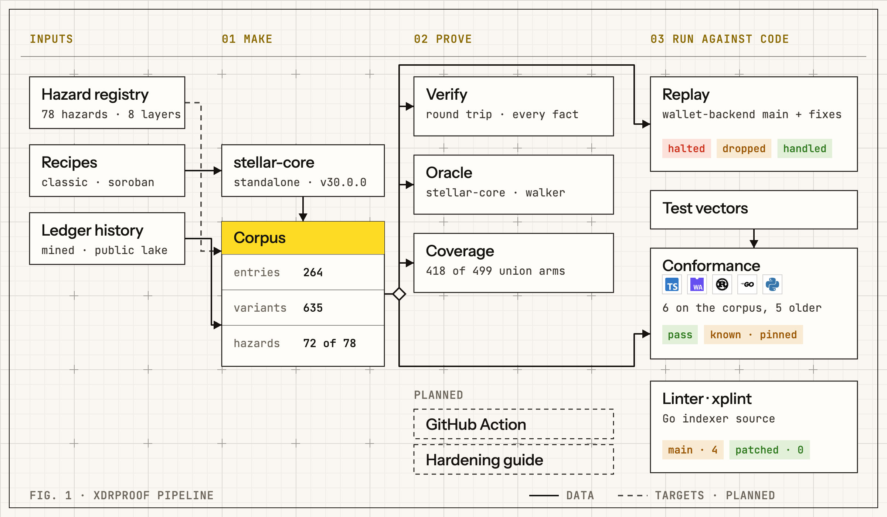

# XDRProof: technical architecture

XDRProof answers the Stellar Community Fund RFP **XDR/CAP-Coverage Audit Tool and Indexer-Hardening Guide**
(SCF #46). This document describes the system as it is built in this repository, and the work the grant would fund.
Every number below comes from a command in the [README](README.md) that anyone can re-run.

<picture>
  <source media="(prefers-color-scheme: dark)" srcset=".github/assets/pipeline-dark.png">
  
</picture>

## 1. What exists today, and what the grant funds

Built before any funding, public, and re-runnable with one command each:

| Part | State | Proof |
|---|---|---|
| Manifest schema (JSON Schema 2020-12) with every field the RFP names | built | `make verify` |
| Hazard registry: 78 named ways readers of the ledger break, in eight layers | built | `caps/registry.json`, [`COVERAGE.md`](COVERAGE.md) |
| Corpus: 263 entries, 634 variants, from a pinned stellar-core v30.0.0 and SDF's public data lake | built | `make verify`, `make generate` |
| Independent readers: stellar-core's own decoder and a schema walker find 737 expected values in their ledgers; `make verify` checks each at its exact field | built | `make oracle` |
| Coverage: 417 of 499 `LedgerCloseMeta` union arms reached; the other 82 classified with a stellar-core source line | built | `make coverage-report` |
| SDK conformance runner: 6 SDK builds on the whole corpus, 5 older releases on fixed-bug regressions | built | `make conformance` |
| Indexer replay harness with a wallet-backend adapter | built | `make replay` |
| `xplint`, a Go linter for the three ingestion mistakes the RFP names | built | `make lint-selftest`, `make lint` |
| Findings reported upstream | 3 posted | [`findings/REPORT.md`](findings/REPORT.md) |

The $60,000 award funds 120 future engineer-days through the v1.0 release: the reviewed guide, per-CAP and golden
agreement reports, a replay memory gate, packages for JavaScript, Go and Rust, CI workflows and a GitHub Action, two
more indexer adapters (stellar-etl and Horizon), five more SDK runners (Java, Swift, Flutter/Dart, PHP and .NET), and
the documentation site (§12). The existing corpus, generator,
oracle, conformance runner, wallet-backend replay and linter are pre-award work, charged at $0. After v1.0, XDRProof
is maintained for 18 months, outside the award budget (§13).

## 2. The RFP's deliverables, mapped

| The RFP asks for | XDRProof |
|---|---|
| A corpus of real and synthetic XDR shapes, each tagged with its CAP and protocol | `entries/` with `manifest.json`; each variant records `protocol`, `source` (mined with lake URL and sha256, or generated with core version, flags and recipe) and `synthetic` |
| Expected decoded values for each entry | `expected.facts`, each backed by `construction`, `snapshot`, `core`, `walker` or `review`; none rests on one decoder alone |
| A coverage report per CAP and per arm | `COVERAGE.md` per arm and per hazard today; per CAP is funded (Tranche 1) |
| Agreement with stellar-core's golden files | `make coverage-goldens` compares arm coverage today (core's 866 goldens reach 254 arms); a `--check-lcm` comparison of decoded field paths and values at a pinned core revision is funded (Tranche 1) |
| A replay harness for indexers, with bounded memory | `replay/` with a documented adapter contract; wallet-backend peaks at 99 MiB per session, the harness at 134 MiB for the whole corpus; a CI gate is funded |
| A linter for the three ingestion mistakes, clean on current wallet-backend | `linter/` catches all three. On unmodified wallet-backend `18db88f4` it reports 4 findings, all true (§9), and 0 with XDRProof's two tested patches, which are offered upstream. Until an unmodified current revision runs clean, this check stays open; each tranche reports the then-current revision's run |
| An indexer-hardening guide, reviewed by a core or platform engineer | funded (Tranches 1 and 3), published only after that review |
| Findings filed upstream | §11 |

## 3. The corpus

**Entries and variants.** An entry is one hazard in one placement, for example "a Soroban authorization tree 245
levels deep". A variant is one ledger that carries it: a protocol (28, 29, 30 and older mined ones), a network
passphrase, and a source. The 263 entries are 226 generated on a bare stellar-core, 36 mined from SDF's public data
lake (mainnet and testnet, protocols 12 to 30) and one both. Families include failed transactions (112 entries, one
per result code and position), muxed accounts, Stellar Asset Contract calls, protocol and config upgrades, Soroban
authorization (CAP-0071 delegates included), maximum lengths, archival and eviction.

**The manifest schema** is [`schema/v1/entry.schema.json`](schema/v1/entry.schema.json). Beyond the RFP's fields,
each entry names its `hazards` and their `placement` in the XDR, and each variant its `focus` transaction, so a test
can find the one transaction the entry is about in a ledger of many. Large mainnet ledgers ship zstd-compressed; size
and sha256 describe the decompressed bytes. `manifest.json` is generated from the entries, one row per variant.

**No redundancy.** `make novelty` runs a leave-one-out check over 1,226 atoms (the arms and enum members an entry
reaches, its hazards, sightings and placements): 182 entries hold an atom no other entry holds, and the other 81 differ
by placement.

## 4. Where the ledgers come from

**Generated.** Recipes in `recipes/` drive a standalone stellar-core v30.0.0, pinned by image digest, with no network,
no RPC, no keys and no funds. `make generate` rebuilds every run twice from scratch, for both lanes (classic and
Soroban), both passphrases, Soroban at protocols 30 and 28, and three emitter-flag profiles (base, Galexie's, bare).
Every pair agrees byte for byte or after normalisation.

**Order is measured, not assumed.** stellar-core writes some operation changes in a hash-dependent order.
`make order-scan` runs each lane 20 times and records which ledgers come out in more than one byte order; their
content never varies. The corpus ships the minority orderings as bytes, so a reader that depends on order fails.

**Mined.** `mined/` vendors 37 ledgers from the public lake with their URLs, sha256 and the query that found them,
for shapes that are cheaper to find than to make (eviction, settings votes, protocol 20 to 22 refunds, V0
envelopes).

## 5. Where "correct" comes from

Expected values are never taken from the SDK under test. `make verify` round-trips every variant through native
rs-stellar-xdr 30.0.0 (depth limit 1,500) and checks every fact. `make oracle` confirms each checkable value with
two readers that share no code with any SDK: stellar-core's own C++ decoder (`dump-xdr`) and XDRProof's schema
walker. Each of the 49 expected 64-bit values, changed in its last digit, is rejected by both.

## 6. Coverage

499 union arms are reachable from `LedgerCloseMeta` in stellar-xdr v30.0. The corpus reaches 417, each by an entry's
own transaction or by its ledger's header and transaction-set shape. The other 82 are classified in
[`coverage/exclusions.json`](coverage/exclusions.json), each with the stellar-core source line that decides it: 39 set
only while a transaction is validated for inclusion, 17 never written by core 30, 18 historical and 8 that need a live
network. None is unclassified. stellar-core's own 866 golden ledger files reach 254 of the 499.

## 7. SDK conformance runner

`conformance/` runs each SDK build as a testee speaking one line-delimited JSON protocol, so a new language needs one
small program. Every corpus variant, 164 strkeys (SEP-0023, all ten types), 14 invalid-input vectors and a depth
ladder run through js-stellar-sdk 17.4.0, `@stellar/stellar-xdr-json` 30.0.0, rs-stellar-xdr 30.0.0, go-stellar-sdk
v0.9.0, py-stellar-base 17.0.1 and its successor `stellar-xdr` 0.2.1; five older releases run the regression vectors
for bugs already fixed upstream. Every known difference is pinned with its cause in `conformance/expectations/`, so a
new failure, and a fix upstream, both fail the run until the expectation is updated.

**Sibling issues.** When an entry breaks one SDK, the same entry runs through every other build. Each build it also
breaks gets its own issue, linked to the first; each build it does not break is recorded as checked in
[`findings/REPORT.md`](findings/REPORT.md). For F-1, only `@stellar/stellar-xdr-json` fails the 13 deep variants;
every other build decodes them.

## 8. Indexer replay harness

**Delivery.** The harness serves corpus ledgers to the indexer through a mock stellar-rpc that answers
`getLedgers`, `getLatestLedger`, `getHealth`, `getNetwork`, `getVersionInfo` and `getLedgerEntries` from the ledger
file alone, and records anything it cannot answer. Each distinct ledger runs in its own isolated session with a fresh
database, so no result depends on another.

**Adapter contract.** An indexer joins with an `adapter.toml` (refs to build, supported probes, memory limit) and a
few shell commands (setup, prepare, start, cursor, stop, finish, teardown) plus an `observe` step that reads its
database. [`replay/adapters/wallet-backend/`](replay/adapters/wallet-backend) is the reference.

**Verdicts from state, never logs.** Probes are derived from the ledger's own meta (transactions present, participants,
signers, trustlines, native and trustline balances, contract creations, address validity, nothing extra). Each variant
gets `handled`, `dropped`, `mishandled`, `stalled`, `crashed` or `halted`, judged from the indexer's cursor, its
process and its stored rows. Every verdict is pinned in `replay/expectations/`, together with a hash of the judged set.

**Results on wallet-backend `main`** (`18db88f4`): 618 of 634 variants handled, none halted. 14 are dropped by causes
already reported upstream (#804, #816, #815, #805, #818, #817) and 2 are mishandled by a bug XDRProof found and
reported (#834). Five fixed bugs (#716, #729, #731, #745, #753) reproduce at the commit before their fix and pass at
the fix.

## 9. Linter

`xplint` is a set of `golang.org/x/tools/go/analysis` analyzers over SSA, one per mistake the RFP names: **XP001**
trusting a field stellar-core does not validate, **XP002** walking or decoding a recursive structure with no limit,
**XP003** deriving participants from the envelope instead of the meta. One taint engine tracks where each value came
from, and a check clears a value only when every source of it passed the check. It emits text, JSON and SARIF 2.1.0
for GitHub code scanning.

`make lint-selftest` catches 44 seeded violations, flags none of 31 good cases and catches 17 mutants. `make lint`
runs it on real code: wallet-backend `main` has 4 findings, all true (the unbounded walk of #820 and three Blend
sites); with XDRProof's two patches it has 0, and wallet-backend's build, vet and tests pass. stellar-etl has 12, all
matching open issues (#504, #462, #488); go-stellar-sdk's ingest packages have 0. It also fires before each upstream
fix of these mistakes and goes quiet after.

## 10. The indexer-hardening guide (funded)

The guide follows the hazard registry's eight layers. Its validated-versus-unvalidated field table and its
language-neutral checklist are generated from the registry and from stellar-core's validation code, with source lines,
so they cannot drift from the corpus. `xdrproof guide check` fails when a hazard has no guide section, or a section
cites an entry that does not exist. A draft goes to a core or platform engineer early; the guide is published only
after their review is incorporated.

## 11. Findings and disclosure

Ordinary bugs are written up in [`findings/REPORT.md`](findings/REPORT.md) and reported upstream after a duplicate
search, each with a figure, a reproduction and, where possible, a tested fix. Halts and crashes anyone can trigger are
reported privately first, through SDF's security channel, and are not published until a fix ships or 90 days pass
([`findings/policy.md`](findings/policy.md)).

Reported so far: [stellar/wallet-backend#834](https://github.com/stellar/wallet-backend/issues/834) (native balances
miss refunds on protocol 20 to 22 ledgers, with a fix replayed against the whole corpus),
[stellar/js-stellar-xdr-json#67](https://github.com/stellar/js-stellar-xdr-json/issues/67) (the decoder refuses a
transaction a standalone stellar-core applied), and a bounded walk offered on
[stellar/wallet-backend#820](https://github.com/stellar/wallet-backend/issues/820). A Python SDK crash was already
fixed on its main branch.

## 12. Distribution and CI (funded)

- **npm:** `xdrproof`, the command-line tool (`verify`, `coverage`, `conformance`, `replay`, `guide check`, `check`),
  and `@xdrproof/corpus`, the corpus with `loadEntries({hazards, caps, protocol})` and test helpers for Vitest and Jest.
- **Go:** the corpus embedded in a Go module with a table-test helper. **Rust:** a loader crate.
- **Workflows**, with actions pinned by SHA and a read-only token by default (release publishing and SARIF upload get
  only the write scopes they need). `check` already runs `make verify`, `make novelty` and the linter self-test on
  every push to `main` and every pull request; the grant adds the oracle and coverage gate to
  it, conformance, replay (sharded, with the memory gate), determinism, golden agreement, an upstream
  watch that opens a pull request when stellar-xdr, stellar-core or an SDK tags a release, with an SDK-pin check
  (`sdk-support.json`: which SDK releases read every corpus variant), and release (tarball, `SHA256SUMS`, build
  attestation, npm provenance).
- **GitHub Action:** `XDRProof/action` runs `xdrproof check` on a pinned corpus in another team's CI and uploads
  SARIF. A pre-commit hook and a golangci-lint plugin run the linter locally. A GitHub App is deliberately not built:
  it would need hosting, a private key and a list of who installed it.
- **Docs:** a page per corpus entry, and a README badge teams can add (Tranche 3).

## 13. Protocol upgrades and maintenance

stellar-xdr's definitions are the input: a new arm, a new enum member or a new CAP shows up as unclassified coverage
and fails `make coverage-report` until an entry or an exclusion covers it (a CI gate from Tranche 2). Enum members
and CAPs are counted but not yet gated. The upstream watch turns each release into a pull request with
the coverage change. After delivery, XDRProof is maintained for 18 months: new protocol shapes, issue triage, and a
release for each protocol upgrade. Before each upgrade, an upgrade-readiness report says which SDK and indexer
versions read the next protocol's shapes (Tranche 3, with the upgrade drill).

## 14. Independence, infrastructure, tracking and status

XDRProof's corpus, schema, tools and adapter contract are Apache-2.0 and run from a clone, with no XDRProof service in
the path; that is how it stays usable by anyone, whatever happens to its maintainer. GitHub hosts the source, CI and
releases; xdrproof.dev hosts the generated documentation. The command-line tool, packages and Action collect no
analytics; the docs site will say so if it ever measures traffic. Milestone status and protocol-upgrade notes are
posted publicly in the repository (`STATUS.md`) and weekly in the Stellar developer Discord's #scf-general.

## 15. Security

The generator runs a standalone stellar-core (no peers) in Docker, with test-only keys committed in the recipes and no
real funds or production credentials; its HTTP port is published on the host while it runs. The repository needs no
secrets.
Every generated ledger is reproducible from its recipe; releases will carry checksums and build attestations (§12). The replay harness runs each indexer in a container with a
memory limit; an indexer that is killed ends its session and is judged from its process and cursor (crashed, or
halted after a retry). Its peak memory is read while it runs, so an out-of-memory kill is recorded without the peak.
A threat model
([`THREAT-MODEL.md`](THREAT-MODEL.md)) covers what XDRProof handles and how it is protected; Tranche 2 completes it with
a monitoring plan (what is watched, what triggers action, who responds), as SCF requires. Disclosure follows
[`findings/policy.md`](findings/policy.md): halts and crashes anyone can trigger are reported privately first.

## 16. Technology

| Part | Choice | Why |
|---|---|---|
| Ledgers | stellar-core v30.0.0 (Docker, pinned digest), SDF's public data lake | the bytes the network writes |
| Reference decoding | rs-stellar-xdr 30.0.0 (native), stellar-core `dump-xdr` | independent of every SDK under test |
| Tooling | Node.js 22, Rust | the corpus tools and the native reader |
| Linter | Go, `golang.org/x/tools` v0.52.0 | the language of wallet-backend, stellar-etl and the SDK's ingest code |
| Replay | Docker, TimescaleDB (wallet-backend's own pinned image) | each indexer in its real environment |
| Licence | Apache-2.0 | |
