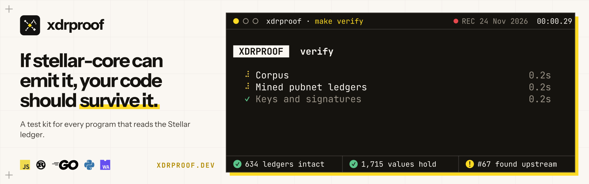
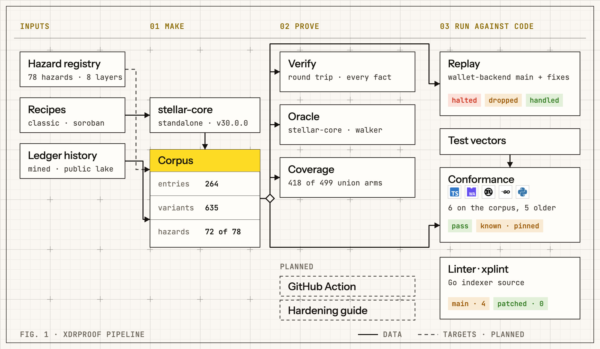
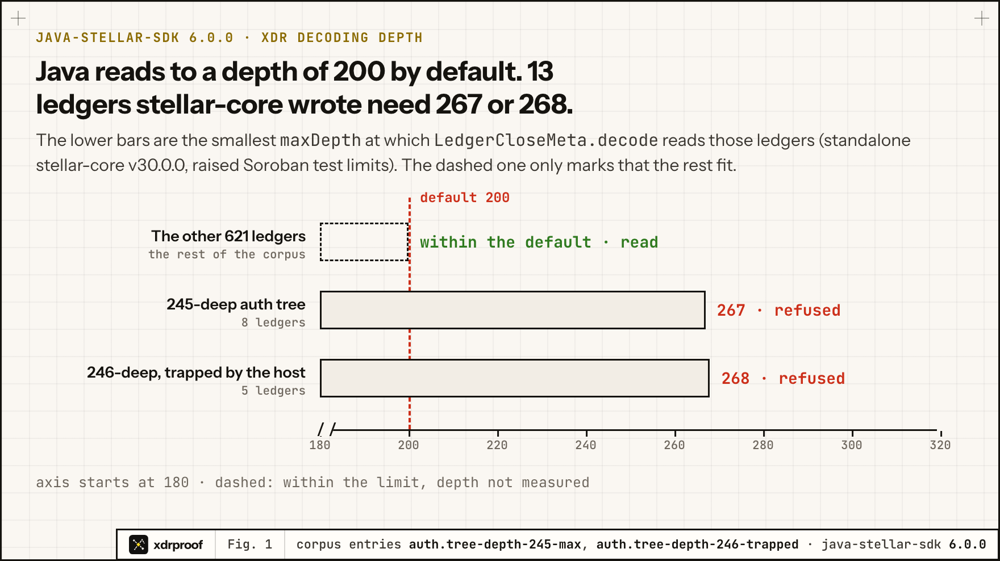

<p align="center">
  <a href="https://xdrproof.dev">
    
  </a>
</p>

<h1 align="center">XDRProof</h1>

<p align="center"><b>Test your Stellar indexer and SDK against the ledger's rarest shapes.</b></p>

<p align="center">
  <a href="./LICENSE"><picture><source media="(prefers-color-scheme: dark)" srcset="https://img.shields.io/github/license/XDRProof/xdrproof?colorA=21262d&colorB=21262d&style=flat"></picture></a>
</p>

<p align="center">
  <b><a href="https://xdrproof.dev/demo">▶ Pitch film (3 min)</a></b> ·
  <b><a href="https://xdrproof.dev/docs/start/quickstart">Quickstart</a></b> ·
  <a href="https://xdrproof.dev/docs">Docs</a> ·
  <a href="https://xdrproof.dev/docs/corpus">Corpus</a> ·
  <a href="https://xdrproof.dev/docs/findings">Findings</a> ·
  <a href="ARCHITECTURE.md">Architecture</a> ·
  <a href="#check-every-claim-yourself">Check every claim</a>
</p>

XDRProof is a shared test kit for every program that reads the Stellar ledger. It holds rare but valid ledgers that
stellar-core actually wrote, each tagged with the CAP that introduced its shape and the answer a correct reader must
give, and tools that run SDKs and indexers against them and name the exact ledger and check they get wrong.

Built in public for the Stellar Community Fund's RFP *XDR/CAP-Coverage Audit Tool and Indexer-Hardening Guide*
(SCF #46). The core was built before any funding, and work continues through every protocol that follows.

## The problem

Every Stellar wallet, explorer and analytics tool depends on code that reads the ledger: an SDK that decodes its XDR,
or an indexer that turns ledgers into database rows. That code is usually tested like this:

1. a developer writes test cases for the transactions they know about;
2. runs them against testnet;
3. ships, and waits.

The network writes far more than anyone thinks to test. A muxed account with a 64-bit ID, a signer that carries a
payload, a contract call that quietly creates a trustline, a failed transaction that still changes state, an
authorization tree 245 levels deep: all valid, all rare. When one reaches an indexer, it stops, or it stores rows that
are wrong, and the first to notice are people looking at a wrong balance. The RFP's own evidence lists 18 recent
sightings like this. In one, wallet-backend cut two kinds of valid address short and stored rows nobody could read back
([#716](https://github.com/stellar/wallet-backend/issues/716)).

What exists today stops short. stellar-core's own golden ledger files test stellar-core: they carry no CAP tags or
expected values, and reach 254 of the 499 shapes a ledger reader can meet. Each SDK keeps its own fixtures, and each
indexer team writes its own. Nothing shared tells a team, before release, which real shapes its code gets wrong.

## What XDRProof does

It gives every team the same hard cases, with the answers checked by stellar-core itself:

- **A corpus** of 264 entries (635 ledger variants), generated by a pinned stellar-core or mined from SDF's public data
  lake, reaching 418 of those 499 shapes. Every checkable expected value is found in stellar-core's own decoding of the
  ledger and by an independent schema walker, and checked at its exact field by a native reader; none comes from the
  SDK under test.
- **A conformance runner** that puts every ledger through the JavaScript, Go, Rust and Python SDKs and pins every
  difference with its cause.
- **A replay harness** that serves each ledger to a real indexer through a mock stellar-rpc and judges what it stored.
  SDF's wallet-backend is the first; an adapter lets any indexer join.
- **xplint**, a Go linter for the three ingestion mistakes behind recent halts, with SARIF for code scanning.

<p align="center">
  <picture>
    <source media="(prefers-color-scheme: dark)" srcset=".github/assets/pipeline-dark.png">
    
  </picture>
</p>

<p align="center"><sub>Built on, and tested against</sub></p>

<table align="center">
  <tr>
    <td align="center"><b>stellar-core</b><br><sub>v30.0.0, writes the ledgers</sub></td>
    <td align="center"><picture><source media="(prefers-color-scheme: dark)" srcset=".github/assets/logos/rust_dark.svg"></picture><br><sub>rs-stellar-xdr 30.0.0</sub></td>
    <td align="center"><br><sub>js-stellar-sdk 17.4.0</sub></td>
    <td align="center"><br><sub>stellar-xdr-json 30.0.0</sub></td>
    <td align="center"><picture><source media="(prefers-color-scheme: dark)" srcset=".github/assets/logos/golang_dark.svg"></picture><br><sub>go-stellar-sdk, wallet-backend, stellar-etl</sub></td>
    <td align="center"><br><sub>py-stellar-base, stellar-xdr</sub></td>
  </tr>
</table>

## Watch the 3-minute pitch

<p align="center">
  <a href="https://xdrproof.dev/demo"></a>
</p>

A 2:58 film for SCF #46: what XDRProof is, the replay that found wallet-backend#834, the verify and conformance runs,
and what the grant buys by date. Every terminal in it is a recorded real run.
[Watch on YouTube](https://youtu.be/zABwPoJ835c) · [Chapters, each linked to its evidence](https://xdrproof.dev/demo)

## Reported upstream

Bugs this kit found are reported to the projects that own them, each with a figure and a reproduction:

<!-- upstream:start · written by tools/upstream-table.mjs from findings/upstream.json; do not edit -->
Status checked on GitHub on 24 Nov 2026.

<table>
  <tr><th>Figure</th><th>Report and what breaks</th><th>Found by</th><th>Status</th></tr>
  <tr>
    <td width="220"><a href="https://github.com/stellar/wallet-backend/issues/834"></a></td>
    <td><a href="https://github.com/stellar/wallet-backend/issues/834"><b>wallet-backend#834</b></a> · new bug<br>Native balances miss Soroban fee refunds on protocol 20–22 ledgers: on pubnet ledger 56085459, seven accounts end 3,349,302 stroops short</td>
    <td>replay</td>
    <td><br><a href="https://github.com/Blockchain-Oracle/wallet-backend/compare/main...fix/pre-p23-soroban-refund-balances"></a></td>
  </tr>
  <tr>
    <td width="220"><a href="https://github.com/stellar/js-stellar-xdr-json/issues/67"></a></td>
    <td><a href="https://github.com/stellar/js-stellar-xdr-json/issues/67"><b>js-stellar-xdr-json#67</b></a> · new bug<br>The decoder Stellar Lab depends on refuses 13 ledgers stellar-core wrote (standalone v30.0.0, raised Soroban test limits): its limit is 500, and the deepest tree core applied needs 519</td>
    <td>verify</td>
    <td></td>
  </tr>
  <tr>
    <td width="220"><a href="https://github.com/stellar/wallet-backend/issues/820#issuecomment-7009772300"></a></td>
    <td><a href="https://github.com/stellar/wallet-backend/issues/820#issuecomment-7009772300"><b>wallet-backend#820</b></a> · fix offered<br>The contract-deploy walk follows authorization trees with no limit; a tested bound offered that stops the walk instead of failing the ledger</td>
    <td>the linter</td>
    <td><br><a href="https://github.com/Blockchain-Oracle/wallet-backend/compare/main...fix/contract-deploy-auth-walk-bounds"></a></td>
  </tr>
  <tr>
    <td width="220"><a href="https://github.com/lightsail-network/java-stellar-sdk/issues/835#issuecomment-7016550020"></a></td>
    <td><a href="https://github.com/lightsail-network/java-stellar-sdk/issues/835#issuecomment-7016550020"><b>java-stellar-sdk#835</b></a> · evidence added<br>The same 13 ledgers need a decoding depth of 267 or 268; Java's default is 200 (evidence on the maintainer's own issue)</td>
    <td>other SDKs, same ledgers</td>
    <td></td>
  </tr>
</table>

The replay also reproduces 5 fixed wallet-backend bugs at the commit before their fix, and each is gone once fixed: <a href="https://github.com/stellar/wallet-backend/issues/716">#716</a>, <a href="https://github.com/stellar/wallet-backend/pull/729">#729</a>, <a href="https://github.com/stellar/wallet-backend/issues/731">#731</a>, <a href="https://github.com/stellar/wallet-backend/issues/745">#745</a>, <a href="https://github.com/stellar/wallet-backend/pull/753">#753</a> (#716's fix exposed #729 on the same ledger, so that ledger passes after both).
<!-- upstream:end -->

Every finding, with its triage and the sibling checks, is in [`findings/REPORT.md`](findings/REPORT.md).

## Check every claim yourself

| Command | What it proves | Needs | Time |
|---|---|---|---|
| `make verify` | All **264 entries (635 variants)**: every entry matches the schema and names known hazards; sha256 and size match; every variant **round-trips byte-for-byte through native rs-stellar-xdr 30.0.0** (depth limit 1500); its focus transaction is present; every expected fact holds; `manifest.json` is current. A second reader, the WASM build `@stellar/stellar-xdr-json`, must agree wherever it can decode | Node ≥ 22.15, Rust | seconds (first build ~1 min) |
| `make oracle` | Every value-checkable fact is **found in stellar-core's own decoding of the ledger** (C++ `dump-xdr`, no code shared with any SDK) **and by XDRProof's schema walker** (no SDK): 741 values; `make verify` checks each at its exact field. Each of the 51 expected 64-bit values, changed in its last digit, is **rejected by both readers** | Docker | ~20 s (the stellar-core image, ~2 GB, downloads once) |
| `make novelty` | **No entry is redundant.** Leave-one-out over 1231 atoms: the arms and enum members an entry reaches (its own transaction and its ledger's shape), its hazards, sightings and placements. 181 entries hold an arm, enum member, hazard or sighting no other entry holds; the other 83 differ by placement, and the 11 whose structure sits wholly inside one other entry are listed for review with `DETAILS=1` | Rust | seconds |
| `make coverage` | 499 XDR union arms are reachable from `LedgerCloseMeta` at v30.0. The corpus entries reach **418**, including all 291 that the 38 mined mainnet and testnet ledgers in `mined/` reach | Python 3 | seconds |
| `make coverage-report` | [`COVERAGE.md`](COVERAGE.md): **418 arms reached by an entry** (its own transaction, or its ledger's header and transaction-set shape; other transactions in the same ledger never count), and each of the other 81 classified with the stellar-core source line that decides it (39 validation-only, 17 never emitted, 18 historical, 7 network-only). Every arm core can still write at protocol 30 on a standalone network is in an entry. Fails if any arm is unclassified | Rust | seconds |
| `make coverage-goldens` | stellar-core's own 866 golden ledger files reach **254 of 499** | + git (downloads ~76 MB once) | ~1 min |
| `make generate` | Every recipe run is rebuilt **twice from scratch** by a bare standalone stellar-core v30.0.0, pinned by image digest (standalone, no peers or RPC; test-only keys; no real funds): both lanes, mainnet and testnet passphrases, Soroban at P30 and P28, three emitter-flag profiles. Every pair agrees, byte for byte or after normalisation, and every shipped generated variant is reproduced | Docker | ~1 min on 10 cores (`make generate-quick` ~15 s) |
| `make order-scan` | 20 fresh runs per lane record which ledgers come out in more than one byte order, and prove the content never varies | Docker | 2 to 5 min |
| `make conformance` | Every corpus variant, 164 strkeys, 14 invalid-input vectors and a depth ladder run through **6 SDK builds**: js-stellar-sdk 17.4.0, `@stellar/stellar-xdr-json` 30.0.0, rs-stellar-xdr 30.0.0, go-stellar-sdk v0.9.0, py-stellar-base 17.0.1 and its successor `stellar-xdr` 0.2.1. The regression vectors for bugs already fixed upstream also run through 5 older releases (js-stellar-sdk 17.2.0, 17.2.1 and 17.3.0, go-stellar-sdk v0.7.1 and v0.7.2). **js-stellar-sdk 17.4.0 and `stellar-xdr` 0.2.1 read all 635 variants exactly as rs-stellar-xdr does**, bytes, SEP-0051 JSON and every expected fact; every other difference is pinned with its cause in [`conformance/expectations/`](conformance/expectations), and an unexpected failure or pass fails the run ([`findings/REPORT.md`](findings/REPORT.md)) | Node, Rust, Docker | ~2 min warm |
| `make replay` | Every corpus ledger replayed into **real wallet-backend builds**, one isolated session each, through a mock stellar-rpc that serves only what the ledger states. Each variant gets a verdict (handled, dropped, mishandled, stalled, crashed, halted) from the indexer's cursor, process and stored rows, judged against probes derived from the ledger itself. **`main`: 618 of 635 variants handled, none halted**; the other 17 reproduce six open upstream issues and one new finding (F-3). **Every fixed failure the corpus holds reproduces before its fix and not after**: #716, #729, #731, #745 and #753, across ten commits. Any indexer can join through a TOML adapter ([`replay/README.md`](replay/README.md)) | Docker | ~20 min cold |
| `make lint-selftest` | The linter (`linter/`, XP001 unvalidated fields, XP002 unbounded recursion, XP003 participants from the envelope; 12 sub-rules) against 44 seeded violations modelled on real code and 17 mutants: **every one caught, no good case flagged** | Docker | ~2 min warm |
| `make lint` | The linter on **wallet-backend `main`: 4 findings, all true** (#820 and the Blend decoder's unchecked addresses, #756's shape), **0 with the two patches in `linter/patches/`**; stellar-etl: 12, all matching open issues (#504, #462, #488); go-stellar-sdk ingest: 0. It also fires before each upstream fix of these mistakes and goes quiet after (#753, #756, #803, 9538b3ca), and on five fixed bugs put back into `main`. Every finding is pinned and triaged in `linter/expectations.json` | Docker | ~3 min warm |

Replay verdicts come from state (the ingest cursor, the process and the rows stored), never from log text; every verdict is pinned in [`replay/expectations/`](replay/expectations), so a new failure, a changed one and a fixed one all fail the run ([`replay/recorded/wallet-backend.md`](replay/recorded/wallet-backend.md)).

## The corpus

264 entries: 226 generated on a bare stellar-core, 37 mined from SDF's public data lake (mainnet and testnet, protocols 12 to 30), one both. Families include failed transactions (112 entries, one per result code and position, plus transactions valid when queued that fail at apply), muxed accounts, Stellar Asset Contract calls, protocol and config upgrades, Soroban authorization, maximum lengths, ScVal edges, archival and eviction, frozen keys, fee bumps, sponsorship, offers and pools, and backfilled old-era ledgers. Three of them, each reproducing a real upstream bug:

| Entry | CAP | Why readers break on it | Reproduces | Variants |
|---|---|---|---|---|
| [`signer.signed-payload.set-options`](entries/signer.signed-payload.set-options/entry.json) | CAP-0040 | A signer whose strkey (`P…`) carries a payload, up to 165 characters | wallet-backend#729, #716 | P28 testnet, **mined** from SDF's public lake; P30 mainnet and testnet passphrases, generated |
| [`sac.trust.creates-trustline`](entries/sac.trust.creates-trustline/entry.json) | CAP-0073 | A contract call creates a classic trustline: no CHANGE_TRUST operation, no event, only a created ledger entry | wallet-backend#731 | P30 and P28, generated |
| [`scval.map.keys-collide-on-native-conversion`](entries/scval.map.keys-collide-on-native-conversion/entry.json) | CAP-0046 | Five distinct map keys (u32 1, i32 1, u64 1, "1", symbol 1) all read as `"1"` once converted to a native object | js-stellar-sdk#1789 | P30, generated |

Every expected value says what backs it: `construction` (we built the transaction with that value), `snapshot` (the SEP-0051 rendering by the pinned stellar-xdr crate), `core`, `walker` or `review`. No expected value is accepted on one decoder's word alone.

## The manifest schema

[`schema/v1/entry.schema.json`](schema/v1/entry.schema.json) is JSON Schema 2020-12. The RFP's required fields map as:

| RFP field | Schema |
|---|---|
| Entry ID | `id` + `variants[].key` (permanent; never reused) |
| CAP | `caps` |
| Protocol version | `variants[].protocol` |
| Source | `variants[].source` (`mined` with lake URL and sha256, or `generated` with core version, emitter flags and recipe) |
| Synthetic flag | `variants[].synthetic` (with `emittable` when true) |
| Expected decoded values | `expected.facts` (order-independent where needed) and `expected.sdk_checks` |

Beyond the RFP's fields, each entry names its `hazards` (with the `placement` in the XDR), and each variant its `focus` transaction. Variants may be zstd-compressed (large mainnet ledgers); size and sha256 describe the decompressed bytes.

[`manifest.json`](manifest.json) is generated from the entries: one row per variant.

## Found while building this

- **stellar-core emits some operation changes in a random order.** Across 20 fresh runs of each recipe lane (`make order-scan`), 18 of 80 classic ledgers and 13 of 80 Soroban ledgers came out in more than one byte order, with identical headers and identical content; two classic ledgers (offers, claimable balances and pool shares changing together) had a different order in every run. The cause is hash-map iteration with a per-process random salt. Entries whose order varies pin an order-normalised hash and list every raw ordering seen (`recipes/*/order-scan/`). An indexer must never depend on change order.
- **stellar-core's own golden ledgers reach 254 of the 499 arms** a `LedgerCloseMeta` reader can meet. Many of the missing arms are result codes that never appear in a closed ledger. [`COVERAGE.md`](COVERAGE.md) now accounts for all 499: the corpus reaches 418, and of the 81 it does not, 39 are set only when a transaction is validated for inclusion and 17 are never written by core 30, so no protocol-30 ledger carries them; 18 appear only in older protocols (every `*_NO_ISSUER` code, for example, stopped at protocol 13); 7 need a live network (a close time agreed after a transaction set was built).
- **Soroban authorization trees up to 245 levels deep apply at Protocol 30; at 246 the transaction is included but traps.** So any indexer cap below about 246 meets real, valid ledgers.
- **The WASM build of rs-stellar-xdr (`@stellar/stellar-xdr-json` 30.0.0) cannot decode those 245-deep ledgers** (`depth limit exceeded`), while native rs-stellar-xdr decodes them. Reported as [stellar/js-stellar-xdr-json#67](https://github.com/stellar/js-stellar-xdr-json/issues/67).
- **Order across ledger keys is unstable between core processes; the STATE → UPDATED pairing for one key is stable.** Readers can rely on the pairing, never on the order between keys.
- **Node flags change the metadata, never the ledger.** Run under the base, Galexie and bare flag profiles, every ledger of both recipe lanes keeps the same header hash. The bare profile changes the metadata content of every ledger but the protocol-upgrade one (no classic events, no fee events, v0 meta extensions). Galexie's extra flags change no classic ledger and 46 Soroban ones: every ledger with a contract call, where each contract event appears twice, in the operation's events and again among the diagnostic events. `make generate` re-measures this into `recipes/<lane>/profiles/`.
- **A Soroban ledger written with diagnostic events on is not byte-reproducible.** Every call carries a `core_metrics` diagnostic event `invoke_time_nsecs`, the wall-clock time the host spent. Two nodes running Galexie's default config write different bytes for the same ledger. The corpus's normalised form zeroes that one value.
- **The public data lake carries TransactionMeta v4 even for 2019 ledgers.** Every lake object inspected (protocols 12, 22 and 29) has v4 meta; the protocol-12 mainnet ledger in `mined/` has v4 meta (and 532 V0 envelopes), because Galexie sets `BACKFILL_STELLAR_ASSET_EVENTS`, which makes stellar-core write v4 at any protocol (`TransactionMeta.cpp:532-536`). A default node replaying the same ledger writes v2 (v3 for protocols 20-22). In those objects only the `LedgerCloseMeta` arm varies by era: v0 at protocol 12, v1 at 22, v2 at 29.
- **A Soroban fee source merged earlier in the same ledger gets no refund.** `fee_charged` is then the full declared maximum, with no refund change and no refund event (`TransactionFrame.cpp:998-1001`). A reader that computes the fee as charge minus refund, or expects a refund for every Soroban transaction, gets it wrong.
- **A valid v1 create-contract authorization is signed over bytes it does not contain.** The host reads `SOROBAN_AUTHORIZED_FUNCTION_TYPE_CREATE_CONTRACT_HOST_FN` into its V2 form and hashes the signature payload from the `CREATE_CONTRACT_V2_HOST_FN` rendering (soroban-env-host `auth.rs`, as stellar-core v30 links it at protocols 28 and 30). Signed over its own bytes, as js-stellar-base's `authorizeEntry` signs it, the entry fails ed25519 verification; signed over the V2 rendering, the contract is created. A verifier that recomputes the payload from the entry rejects a signature core accepted (hazard H-B16; `tools/auth-payload-check.mjs` re-checks it with hand-encoded preimages, no SDK). This is by design since protocol 22, to keep one valid payload per action ([stellar discussion #1501](https://github.com/orgs/stellar/discussions/1501)); transactions built through RPC simulation get it right, offline signers must sign the V2 rendering.
- **Codes read as submission-only appear in closed ledgers.** Core re-checks sequence numbers, signatures and preconditions at apply, so a classic transaction earlier in the same ledger can make a queued Soroban transaction fail with `txBAD_AUTH_EXTRA` (a signature needed at submission becomes surplus once a master weight rises) and fee-bump inner transactions fail with `txBAD_SEQ`, `txNO_ACCOUNT`, `txBAD_AUTH`, `txBAD_AUTH_EXTRA` or `txBAD_MIN_SEQ_AGE_OR_GAP` inside `txFEE_BUMP_INNER_FAILED`.
- **wallet-backend's balances and its own history disagree on protocol 22.** Before protocol 23 a Soroban fee refund is credited in `txChangesAfter`; wallet-backend's native balances never read it, so replaying pubnet ledger 56085459 leaves its 7 refunded accounts short by exactly their refund, while its own `BALANCE` history rows add up to the ledger (reported as [stellar/wallet-backend#834](https://github.com/stellar/wallet-backend/issues/834); F-3 in [`findings/REPORT.md`](findings/REPORT.md)). Current ledgers carry refunds in `postTxApplyFeeProcessing`, which it reads.

## What comes next

The SCF grant would fund the work that turns this into a check every Stellar team can run, and keeps it current:
the indexer-hardening guide, reviewed by a core or platform engineer before it is published; per-CAP coverage and
agreement with stellar-core's golden files; a memory gate on replay; npm, Go and Rust packages; CI workflows and a
GitHub Action; stellar-etl and a third indexer in the replay harness; conformance runners for the Java, Swift, Dart, PHP
and .NET SDKs; and the documentation site. [`ARCHITECTURE.md`](ARCHITECTURE.md) has the detail. After v1.0, XDRProof is
maintained for 18 months.

## Limits today

- The linter reports four true findings on unmodified wallet-backend `main`, and none with the two patches it offers
  upstream; it runs clean on current wallet-backend only once those land.
- The indexer-hardening guide is not written yet, and no package or GitHub Action is published yet.
- The replay harness has one indexer adapter so far (wallet-backend).
- The corpus targets protocol 30 and the releases around it.

## Layout

```
schema/v1/            manifest schema (v1.1)
caps/registry.json    the 78 hazards
catalog/<id>.json     hand-written entry sources: intent, focus, hazards, facts (format in catalog/README.md)
entries/<id>/         GENERATED by make build: entry.json + one XDR file per variant (zstd for large mined ones)
manifest.json         generated index
COVERAGE.md           generated: every arm reached or classified; coverage/exclusions.json holds the classifications
recipes/classic/      classic recipes for a bare standalone stellar-core (incl. a failure suite)
recipes/soroban/      Soroban recipes + two test contracts (kit, kit2)
recipes/flags/        emitter-flag profiles: base, galexie, bare
recipes/core-image    the stellar-core image, pinned by digest
mined/                38 ledgers from SDF's public lake (zstd), index.json with provenance and findings, queries/ that located them
tools/                build, verify, oracle (core-facts + walker), novelty, coverage-report, order-scan, native/ (rs-stellar-xdr reader)
conformance/          runner, testee protocol, JS/WASM/Rust/Go/Python testees, vectors, expectations, recorded matrix
findings/             REPORT.md (triaged SDK and indexer findings with upstream links), policy.md (disclosure)
replay/               harness, mock stellar-rpc, wallet-backend adapter, sightings, expectations, recorded matrix
linter/               xplint (Go analyzers), fixtures and mutants, targets, triaged expectations, patches for wallet-backend
```

## Independence and licence

XDRProof is an independent open-source project. It is not affiliated with or endorsed by the Stellar Development
Foundation. Code and data are licensed under [Apache-2.0](LICENSE).
