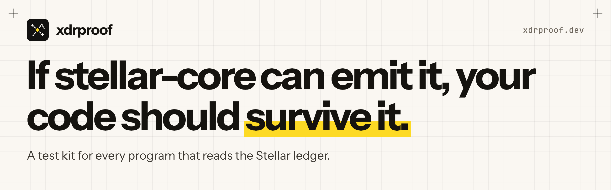

<picture>
  <source media="(prefers-color-scheme: dark)" srcset=".github/assets/banner-dark.png">
  
</picture>

# XDRProof

**Test your Stellar indexer and SDK against the ledger's rarest shapes.**

XDRProof is a shared corpus of rare but valid Stellar ledger data, as bytes stellar-core actually emitted. Each entry is tagged with the CAP that introduced it and carries the values a correct reader must return. Around the corpus sit tools that check it with independent readers, replay it into real indexers, run JavaScript, Go, Rust and Python SDK builds against test vectors for the same shapes, and lint Go indexer code for the three ingestion mistakes the corpus is built around.

> **Status: early, built in public.** This repository backs our proposal to the Stellar Community Fund's RFP *XDR/CAP-Coverage Audit Tool and Indexer-Hardening Guide* (SCF #46). It holds the manifest schema, the hazard registry, 263 corpus entries, the generator recipes and runnable reproductions of real upstream bugs. Every number below is re-measured by the command next to it.

## Built from a failure-mode blueprint

[`caps/registry.json`](caps/registry.json) lists **78 hazards**: named ways readers of the Stellar ledger break, in eight layers. Examples: a muxed account stored without its ID, a contract call that creates a trustline with no event, a failed transaction that still changes state, a valid ledger a decoder refuses. Each hazard carries its evidence: an upstream issue, a protocol rule or a measurement. Every corpus entry names the hazards it targets and where in the XDR they sit, so the corpus grows by purpose, not by volume. 72 hazards are targeted by entries; the other 6 are about invalid input, prose or release policy, which no valid ledger can carry, and belong to conformance, the guide and the release channel.

## Check every claim yourself

| Command | What it proves | Needs | Time |
|---|---|---|---|
| `make verify` | All **263 entries (634 variants)**: every entry matches the schema and names known hazards; sha256 and size match; every variant **round-trips byte-for-byte through native rs-stellar-xdr 30.0.0** (depth limit 1500); its focus transaction is present; every expected fact holds; `manifest.json` is current. A second reader, the WASM build `@stellar/stellar-xdr-json`, must agree wherever it can decode | Node ≥ 22.15, Rust | seconds (first build ~1 min) |
| `make oracle` | Every value-checkable fact is **confirmed by stellar-core's own decoder** (C++ `dump-xdr`, no code shared with any SDK) **and by XDRProof's schema walker** (no SDK): 737 values. Each of the 49 expected 64-bit values, changed in its last digit, is **rejected by both readers** | Docker | seconds |
| `make novelty` | **No entry is redundant.** Leave-one-out over 1226 atoms: the arms and enum members an entry reaches (its own transaction and its ledger's shape), its hazards, sightings and placements. 182 entries hold an arm, enum member, hazard or sighting no other entry holds; the other 81 differ by placement, and the 11 whose structure sits wholly inside one other entry are listed for review | Rust | seconds |
| `make coverage` | 499 XDR union arms are reachable from `LedgerCloseMeta` at v30.0. The corpus entries reach **417**, including all 289 that the 37 mined mainnet and testnet ledgers in `mined/` reach | Python 3 | seconds |
| `make coverage-report` | [`COVERAGE.md`](COVERAGE.md): **417 arms reached by an entry** (its own transaction, or its ledger's header and transaction-set shape; other transactions in the same ledger never count), and each of the other 82 classified with the stellar-core source line that decides it (39 validation-only, 17 never emitted, 18 historical, 8 network-only). Every arm core can still write at protocol 30 on a standalone network is in an entry. Fails if any arm is unclassified | Rust | seconds |
| `make coverage-goldens` | stellar-core's own 866 golden ledger files reach **254 of 499** | + git (downloads ~76 MB once) | ~1 min |
| `make generate` | Every recipe run is rebuilt **twice from scratch** by a bare standalone stellar-core v30.0.0, pinned by image digest (no RPC, no network, no keys or funds): both lanes, mainnet and testnet passphrases, Soroban at P30 and P28, three emitter-flag profiles. Every pair agrees, byte for byte or after normalisation, and every shipped generated variant is reproduced | Docker | ~10 min (`make generate-quick` ~3 min) |
| `make order-scan` | 20 fresh runs per lane record which ledgers come out in more than one byte order, and prove the content never varies | Docker | ~15 min |
| `make conformance` | Every corpus variant, 164 strkeys, 14 invalid-input vectors and a depth ladder run through **11 SDK builds**: js-stellar-sdk 17.4.0, `@stellar/stellar-xdr-json` 30.0.0, rs-stellar-xdr 30.0.0, go-stellar-sdk v0.9.0, py-stellar-base 17.0.1 and its successor `stellar-xdr` 0.2.1, plus the releases around upstream fixes. **js-stellar-sdk 17.4.0 and `stellar-xdr` 0.2.1 read all 634 variants exactly as rs-stellar-xdr does**, bytes, SEP-0051 JSON and every expected fact; every other difference is pinned with its cause in [`conformance/expectations/`](conformance/expectations), and an unexpected failure or pass fails the run ([`findings/REPORT.md`](findings/REPORT.md)) | Node, Rust, Docker | ~2 min warm |
| `make replay` | Every corpus ledger replayed into **real wallet-backend builds**, one isolated session each, through a mock stellar-rpc that serves only what the ledger states. Each variant gets a verdict (handled, dropped, mishandled, stalled, crashed, halted) from the indexer's cursor, process and stored rows, judged against probes derived from the ledger itself. **`main`: 618 of 634 variants handled, none halted**; the other 16 reproduce five open upstream issues and one new finding (F-3). **Every fixed failure the corpus holds reproduces before its fix and not after**: #716, #729, #731, #745 and #753, across ten commits. Any indexer can join through a TOML adapter ([`replay/README.md`](replay/README.md)) | Docker | ~20 min cold |
| `make lint-selftest` | The linter (`linter/`, XP001 unvalidated fields, XP002 unbounded recursion, XP003 participants from the envelope; 12 sub-rules) against 44 seeded violations modelled on real code and 17 mutants: **every one caught, no good case flagged** | Docker | ~2 min warm |
| `make lint` | The linter on **wallet-backend `main`: 4 findings, all true** (#820 and the Blend decoder's unchecked addresses, #756's shape), **0 with the two patches in `linter/patches/`**; stellar-etl: 12, all matching open issues (#504, #462, #488); go-stellar-sdk ingest: 0. It also fires before each upstream fix of these mistakes and goes quiet after (#753, #756, #803, 9538b3ca), and on five fixed bugs put back into `main`. Every finding is pinned and triaged in `linter/expectations.json` | Docker | ~3 min warm |

Replay verdicts come from state (the ingest cursor, the process and the rows stored), never from log text; every verdict is pinned in [`replay/expectations/`](replay/expectations), so a new failure, a changed one and a fixed one all fail the run ([`replay/recorded/wallet-backend.md`](replay/recorded/wallet-backend.md)).

## The corpus

263 entries: 226 generated on a bare stellar-core, 36 mined from SDF's public data lake (mainnet and testnet, protocols 12 to 30), one both. Families include failed transactions (112 entries, one per result code and position, plus transactions valid when queued that fail at apply), muxed accounts, Stellar Asset Contract calls, protocol and config upgrades, Soroban authorization, maximum lengths, ScVal edges, archival and eviction, frozen keys, fee bumps, sponsorship, offers and pools, and backfilled old-era ledgers. Three of them, each reproducing a real upstream bug:

| Entry | CAP | Why readers break on it | Reproduces | Variants |
|---|---|---|---|---|
| [`signer.signed-payload.set-options`](entries/signer.signed-payload.set-options/entry.json) | CAP-0040 | A signer whose strkey (`P…`) carries a payload, up to 165 characters | wallet-backend#729, #716 | P28 testnet, **mined** from SDF's public lake; P30 mainnet and testnet passphrases, generated |
| [`sac.trust.creates-trustline`](entries/sac.trust.creates-trustline/entry.json) | CAP-0073 | A contract call creates a classic trustline: no CHANGE_TRUST operation, no event, only a created ledger entry | wallet-backend#731 | P30 and P28, generated |
| [`scval.map.keys-collide-on-native-conversion`](entries/scval.map.keys-collide-on-native-conversion/entry.json) | CAP-0046 | Five distinct map keys (u32 1, i32 1, u64 1, "1", symbol 1) all read as `"1"` once converted to a native object | js-stellar-sdk#1789 | P30, generated |

Every expected value says what backs it: `construction` (we built the transaction with that value), `snapshot` (the SEP-0051 rendering by the pinned stellar-xdr crate), `core`, `walker` or `review`. No expected value is accepted on one decoder's word alone.

## The manifest schema

[`schema/v1/entry.schema.json`](schema/v1/entry.schema.json) is JSON Schema 2020-12. The RFP's required fields map as:

| RFP field | Schema |
|---|---|
| Entry ID | `id` + `variants[].key` (permanent; never reused) |
| CAP | `caps` |
| Protocol version | `variants[].protocol` |
| Source | `variants[].source` (`mined` with lake URL and sha256, or `generated` with core version, emitter flags and recipe) |
| Synthetic flag | `variants[].synthetic` (with `emittable` when true) |
| Expected decoded values | `expected.facts` (order-independent where needed) and `expected.sdk_checks` |

Beyond the RFP's fields, each entry names its `hazards` (with the `placement` in the XDR), and each variant its `focus` transaction. Variants may be zstd-compressed (large mainnet ledgers); size and sha256 describe the decompressed bytes.

[`manifest.json`](manifest.json) is generated from the entries: one row per variant.

## Found while building this

- **stellar-core emits some operation changes in a random order.** Across 20 fresh runs of each recipe lane (`make order-scan`), 18 of 80 classic ledgers and 13 of 80 Soroban ledgers came out in more than one byte order, with identical headers and identical content; two classic ledgers (offers, claimable balances and pool shares changing together) had a different order in every run. The cause is hash-map iteration with a per-process random salt. Entries whose order varies pin an order-normalised hash and list every raw ordering seen (`recipes/*/order-scan/`). An indexer must never depend on change order.
- **stellar-core's own golden ledgers reach 254 of the 499 arms** a `LedgerCloseMeta` reader can meet. Many of the missing arms are result codes that never appear in a closed ledger. [`COVERAGE.md`](COVERAGE.md) now accounts for all 499: the corpus reaches 417, and of the 82 it does not, 39 are set only when a transaction is validated for inclusion and 17 are never written by core 30, so no protocol-30 ledger carries them; 18 appear only in older protocols (every `*_NO_ISSUER` code, for example, stopped at protocol 13); 8 need a live network (a close time agreed after a transaction set was built).
- **Soroban authorization trees up to 245 levels deep apply at Protocol 30; at 246 the transaction is included but traps.** So any indexer cap below about 246 meets real, valid ledgers.
- **The WASM build of rs-stellar-xdr (`@stellar/stellar-xdr-json` 30.0.0) cannot decode those 245-deep ledgers** (`depth limit exceeded`), while native rs-stellar-xdr decodes them. Reported as [stellar/js-stellar-xdr-json#67](https://github.com/stellar/js-stellar-xdr-json/issues/67).
- **Order across ledger keys is unstable between core processes; the STATE → UPDATED pairing for one key is stable.** Readers can rely on the pairing, never on the order between keys.
- **Node flags change the metadata, never the ledger.** Run under the base, Galexie and bare flag profiles, every ledger of both recipe lanes keeps the same header hash. The bare profile changes the metadata content of every ledger but the protocol-upgrade one (no classic events, no fee events, v0 meta extensions). Galexie's extra flags change no classic ledger and 46 Soroban ones: every ledger with a contract call, where each contract event appears twice, in the operation's events and again among the diagnostic events. `make generate` re-measures this into `recipes/<lane>/profiles/`.
- **A Soroban ledger written with diagnostic events on is not byte-reproducible.** Every call carries a `core_metrics` diagnostic event `invoke_time_nsecs`, the wall-clock time the host spent. Two nodes running Galexie's default config write different bytes for the same ledger. The corpus's normalised form zeroes that one value.
- **The public data lake carries TransactionMeta v4 even for 2019 ledgers.** Every lake object inspected (protocols 12, 22 and 29) has v4 meta; the protocol-12 mainnet ledger in `mined/` has v4 meta (and 532 V0 envelopes), because Galexie sets `BACKFILL_STELLAR_ASSET_EVENTS`, which makes stellar-core write v4 at any protocol (`TransactionMeta.cpp:532-536`). A default node replaying the same ledger writes v2 (v3 for protocols 20-22). In those objects only the `LedgerCloseMeta` arm varies by era: v0 at protocol 12, v1 at 22, v2 at 29.
- **A Soroban fee source merged earlier in the same ledger gets no refund.** `fee_charged` is then the full declared maximum, with no refund change and no refund event (`TransactionFrame.cpp:998-1001`). A reader that computes the fee as charge minus refund, or expects a refund for every Soroban transaction, gets it wrong.
- **A valid v1 create-contract authorization is signed over bytes it does not contain.** The host reads `SOROBAN_AUTHORIZED_FUNCTION_TYPE_CREATE_CONTRACT_HOST_FN` into its V2 form and hashes the signature payload from the `CREATE_CONTRACT_V2_HOST_FN` rendering (soroban-env-host `auth.rs`, as stellar-core v30 links it at protocols 28 and 30). Signed over its own bytes, as js-stellar-base's `authorizeEntry` signs it, the entry fails ed25519 verification; signed over the V2 rendering, the contract is created. A verifier that recomputes the payload from the entry rejects a signature core accepted (hazard H-B16; `tools/auth-payload-check.mjs` re-checks it with hand-encoded preimages, no SDK). This is by design since protocol 22, to keep one valid payload per action ([stellar discussion #1501](https://github.com/orgs/stellar/discussions/1501)); transactions built through RPC simulation get it right, offline signers must sign the V2 rendering.
- **Codes read as submission-only appear in closed ledgers.** Core re-checks sequence numbers, signatures and preconditions at apply, so a classic transaction earlier in the same ledger can make a queued Soroban transaction fail with `txBAD_AUTH_EXTRA` (a signature needed at submission becomes surplus once a master weight rises) and fee-bump inner transactions fail with `txBAD_SEQ`, `txNO_ACCOUNT`, `txBAD_AUTH`, `txBAD_AUTH_EXTRA` or `txBAD_MIN_SEQ_AGE_OR_GAP` inside `txFEE_BUMP_INNER_FAILED`.
- **wallet-backend's balances and its own history disagree on protocol 22.** Before protocol 23 a Soroban fee refund is credited in `txChangesAfter`; wallet-backend's native balances never read it, so replaying pubnet ledger 56085459 leaves its 7 refunded accounts short by exactly their refund, while its own `BALANCE` history rows add up to the ledger (reported as [stellar/wallet-backend#834](https://github.com/stellar/wallet-backend/issues/834); F-3 in [`findings/REPORT.md`](findings/REPORT.md)). Current ledgers carry refunds in `postTxApplyFeeProcessing`, which it reads.

## Layout

```
schema/v1/            manifest schema (v1.1)
caps/registry.json    the 78 hazards
catalog/<id>.json     hand-written entry sources: intent, focus, hazards, facts (format in catalog/README.md)
entries/<id>/         GENERATED by make build: entry.json + one XDR file per variant (zstd for large mined ones)
manifest.json         generated index
COVERAGE.md           generated: every arm reached or classified; coverage/exclusions.json holds the classifications
recipes/classic/      classic recipes for a bare standalone stellar-core (incl. a failure suite)
recipes/soroban/      Soroban recipes + two test contracts (kit, kit2)
recipes/flags/        emitter-flag profiles: base, galexie, bare
recipes/core-image    the stellar-core image, pinned by digest
mined/                37 ledgers from SDF's public lake (zstd), index.json with provenance and findings, queries/ that located them
tools/                build, verify, oracle (core-facts + walker), novelty, coverage-report, order-scan, native/ (rs-stellar-xdr reader)
conformance/          runner, testee protocol, JS/WASM/Rust/Go/Python testees, vectors, expectations, recorded matrix
findings/             REPORT.md (triaged SDK and indexer findings with upstream links), policy.md (disclosure)
replay/               harness, mock stellar-rpc, wallet-backend adapter, sightings, expectations, recorded matrix
linter/               xplint (Go analyzers), fixtures and mutants, targets, triaged expectations, patches for wallet-backend
```

## Architecture

[`ARCHITECTURE.md`](ARCHITECTURE.md) describes how the parts fit, what is built and what the SCF grant would fund.

## Independence and licence

XDRProof is an independent open-source project. It is not affiliated with or endorsed by the Stellar Development Foundation. Code and data are licensed under [Apache-2.0](LICENSE).
