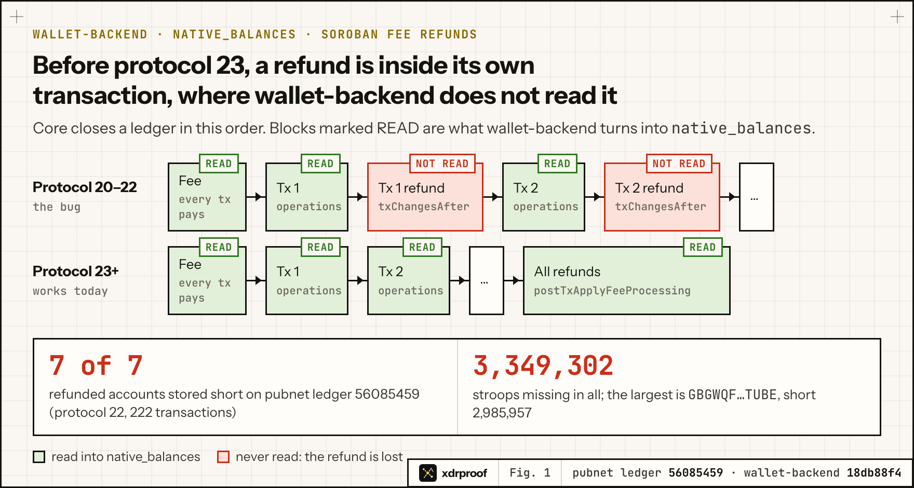
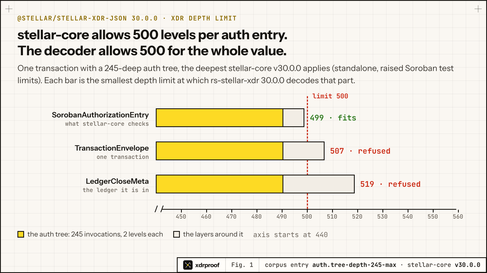
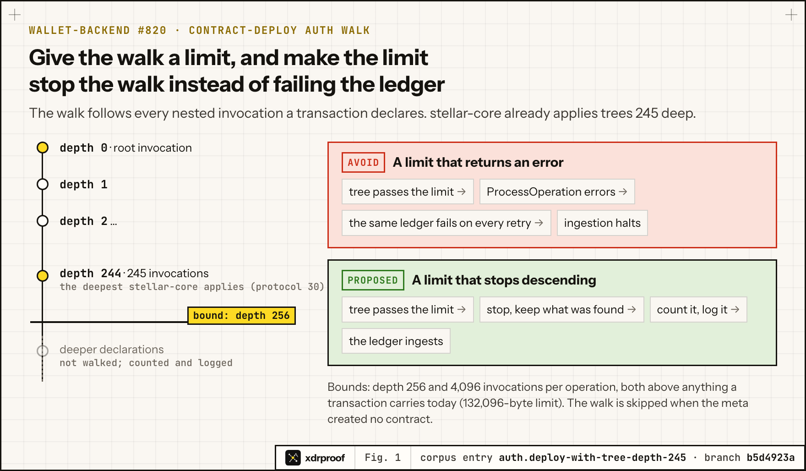
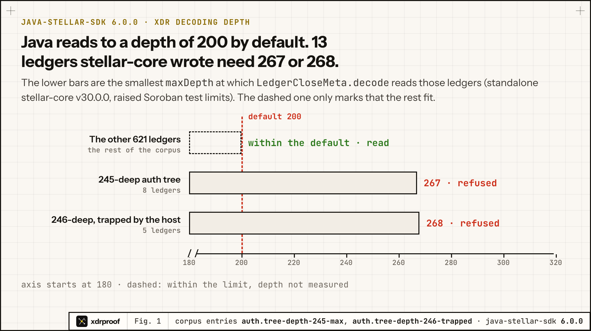

# Findings

What XDRProof's runs turn up in SDKs, decoders and indexers, triaged. Every row is reproduced by a command
(`make conformance`, `make replay`, `make verify`) and pinned in `conformance/expectations/` or
`replay/expectations/`, so a fix upstream shows up as an unexpected pass and the row is updated. Issues that let anyone halt or crash an indexer are not listed here
(see [policy.md](policy.md)).

## Reported upstream, at a glance

<!-- upstream:start · written by tools/upstream-table.mjs from findings/upstream.json; do not edit -->
Status checked on GitHub on 24 Nov 2026.

<table>
  <tr><th>Figure</th><th>Report and what breaks</th><th>Found by</th><th>Status</th></tr>
  <tr>
    <td width="220"></td>
    <td><a href="https://github.com/stellar/wallet-backend/issues/834"><b>wallet-backend#834</b></a> · new bug Native balances miss Soroban fee refunds on protocol 20–22 ledgers: on pubnet ledger 56085459, seven accounts end 3,349,302 stroops short</td>
    <td>replay</td>
    <td> </td>
  </tr>
  <tr>
    <td width="220"></td>
    <td><a href="https://github.com/stellar/js-stellar-xdr-json/issues/67"><b>js-stellar-xdr-json#67</b></a> · new bug The decoder Stellar Lab depends on refuses 13 ledgers stellar-core wrote (standalone v30.0.0, raised Soroban test limits): its limit is 500, and the deepest tree core applied needs 519</td>
    <td>verify</td>
    <td></td>
  </tr>
  <tr>
    <td width="220"></td>
    <td><a href="https://github.com/stellar/wallet-backend/issues/820#issuecomment-7009772300"><b>wallet-backend#820</b></a> · fix offered The contract-deploy walk follows authorization trees with no limit; a tested bound offered that stops the walk instead of failing the ledger</td>
    <td>the linter</td>
    <td> </td>
  </tr>
  <tr>
    <td width="220"></td>
    <td><a href="https://github.com/lightsail-network/java-stellar-sdk/issues/835#issuecomment-7016550020"><b>java-stellar-sdk#835</b></a> · evidence added The same 13 ledgers need a decoding depth of 267 or 268; Java's default is 200 (evidence on the maintainer's own issue)</td>
    <td>other SDKs, same ledgers</td>
    <td></td>
  </tr>
</table>

The replay also reproduces 5 fixed wallet-backend bugs at the commit before their fix, and each is gone once fixed: <a href="https://github.com/stellar/wallet-backend/issues/716">#716</a>, <a href="https://github.com/stellar/wallet-backend/pull/729">#729</a>, <a href="https://github.com/stellar/wallet-backend/issues/731">#731</a>, <a href="https://github.com/stellar/wallet-backend/issues/745">#745</a>, <a href="https://github.com/stellar/wallet-backend/pull/753">#753</a> (#716's fix exposed #729 on the same ledger, so that ledger passes after both).
<!-- upstream:end -->

## Not reported upstream before XDRProof

| ID | Where | What | Status |
|---|---|---|---|
| F-1 | `@stellar/stellar-xdr-json` 30.0.0 (rs-stellar-xdr compiled to WASM) | Refuses 13 corpus variants that stellar-core wrote (`depth limit exceeded`): 8 whose Soroban auth tree is 245 levels deep, the deepest that applies, and 5 at 246, which core includes and traps. The package hard-codes `XDR_MAX_DEPTH = 500` ([src/lib.rs](https://github.com/stellar/js-stellar-xdr-json/blob/main/src/lib.rs), line 10), set to mirror the Soroban host's budget limit, and applies it to the whole `LedgerCloseMeta`, whose path down to the auth tree is deeper. js-stellar-sdk 17.4.0, go-stellar-sdk v0.9.0, both Python decoders and native rs-stellar-xdr with a larger limit read them. Of the sampled nested-`ScVal` depths it decodes 64 and refuses 100. | [stellar/js-stellar-xdr-json#67](https://github.com/stellar/js-stellar-xdr-json/issues/67), filed 19 Nov 2026 with the measured depths (auth entry 499, transaction 507, ledger 519, against a limit of 500) and a reproducer |
| F-2 | `stellar-sdk` 17.0.1 (Python) | `to_json` raises `Unknown SCAddress type: 5` on a CAP-0084 muxed contract address that `from_xdr` decodes (2 corpus variants). py-stellar-base#1234, the protocol 30 tracking issue, asked for CAP-0084 support and warned that muxed contract values would fail; this exact failure is not reported, and #1269 does not cover it. | fixed on main by the switch to `stellar-xdr` (py-stellar-base#1268): `stellar-xdr` 0.2.1 passes |
| F-3 | wallet-backend `main` (`18db88f4`), native balances | Before protocol 23 a Soroban fee refund is credited in `txChangesAfter`. wallet-backend builds `native_balances` from fee changes, operation changes and the protocol 23+ post-apply refunds only ([accounts.go](https://github.com/stellar/wallet-backend/blob/18db88f4ba481c49a782d157be42177700c4385e/internal/indexer/processors/accounts.go#L96-L122)), so on pubnet ledger 56085459 (protocol 22) the 7 refunded accounts end short by exactly their refund (2,985,957 stroops for one of them), while wallet-backend's own `BALANCE` history rows for the same account add up to the ledger. It bites only when live ingestion processes protocol 20-22 ledgers, such as a catch-up from the data lake; current ledgers carry the refund in `postTxApplyFeeProcessing`, which it reads. No issue or PR mentions it (searched "refund", "txChangesAfter", "protocol 22"). | [stellar/wallet-backend#834](https://github.com/stellar/wallet-backend/issues/834), filed 19 Nov 2026. Fix: [`fix/pre-p23-soroban-refund-balances`](https://github.com/Blockchain-Oracle/wallet-backend/compare/main...fix/pre-p23-soroban-refund-balances); the whole corpus replayed into it handles both variants of ledger 56085459 and changes no other verdict. A PR follows if a maintainer accepts the approach. On 20 Nov 2026 a [one-file Go test](https://github.com/stellar/wallet-backend/issues/834#issuecomment-7050147057) was added to the issue: no Docker and nothing from XDRProof, it downloads the ledger from the public data lake and runs `indexer.ProcessLedger`; it fails on `main` at 76194899 (7 balances, 3,349,302 stroops short) and passes on the fix branch and on 76194899 with the fix cherry-picked |
| F-4 | wallet-backend `main`, Blend decoder | `internal/services/blend/scval.go` `addrString` turns any `ScAddress` into a string with `String()`, and three call sites use it as an account (two map keys that outlive the call, and `WithAccount`); a fourth stores it as the BLND token's contract ID (`comet.go:337`). wallet-backend fixed this shape in its SEP-41 processor (#756) with `types.StorableAddressString`, noting that "a real contract cannot emit them today"; the Blend decoder, added later (#798), does not use it. Not reachable today: only pinned Blend WASM is decoded, Blend takes `Address` arguments, and the host refuses B and L addresses and a muxed address in a contract-data key (corpus `deploy.from-claimable-balance-address`, `deploy.from-liquidity-pool-address`, `scval.muxed-address-key-trapped`). Found by `xplint` (`XP001/muxed-as-account`); `linter/patches/wallet-backend-blend-address.diff` fixes it, and wallet-backend's build, vet and Blend tests pass with it. | not filed: no reachable case today, and the Stellar contribution guide asks not to file speculative findings. Fix ready on [`fix/blend-storable-address`](https://github.com/Blockchain-Oracle/wallet-backend/compare/main...fix/blend-storable-address) |
| H-B16 | soroban-env-host, every signer | A v1 create-contract authorization is signed over its V2 rendering, not its own bytes. By design since protocol 22 ([stellar discussion #1501](https://github.com/orgs/stellar/discussions/1501)): a hazard for offline signers and signature verifiers, not a bug. `tools/auth-payload-check.mjs` checks it without any SDK. | documented in the corpus |

## Sibling sweeps

When a finding turns up in one SDK or indexer, the same entries go through the others. Statuses: **tested, affected**;
**tested, not affected**; **inferred** (read from the code, not run); **not tested**.

| Finding | Where else it was checked | Status |
|---|---|---|
| F-1: 13 deep-auth-tree variants refused by `@stellar/stellar-xdr-json` 30.0.0 | java-stellar-sdk 6.0.0 (`fromXdrByteArray`, default depth 200; the variants need 267 and 268; all decode and round-trip at 1,500), 19 Nov 2026. `master` at d0938106 keeps the same default | **tested, affected**: evidence for point 3 of [lightsail-network/java-stellar-sdk#835](https://github.com/lightsail-network/java-stellar-sdk/issues/835), which its maintainer opened on 16 Nov; the 13 ledgers and their depths were [posted there](https://github.com/lightsail-network/java-stellar-sdk/issues/835#issuecomment-7016550020) on 19 Nov |
| F-1 | js-stellar-sdk 17.4.0, go-stellar-sdk v0.9.0, py-stellar-base 17.0.1, stellar-xdr 0.2.1, rs-stellar-xdr 30.0.0 at depth 1,500 (`make conformance`); stellar-php-sdk 1.18.0 (all 634 variants round-trip, separate sweep, 19 Nov 2026) | **tested, not affected** |
| F-3: pre-protocol-23 Soroban refunds in `txChangesAfter` missing from wallet-backend's `native_balances` | Horizon and stellar-etl read ledger changes through go-stellar-sdk `LedgerTransaction.GetChanges()`, which includes `TxChangesAfter` for TransactionMeta v2, v3 and v4 (`ingest/ledger_transaction.go`, `changesWithSplit`) | **inferred, not affected**; the Horizon and stellar-etl replays (Tranches 2 and 3) will test it |

## Reproduced in wallet-backend by `make replay`

The whole corpus replayed into wallet-backend `main` (`76194899`, 2026-11-24; the same verdicts as `18db88f4` on 2026-11-18): 618 of 634 variants handled, none
halted. The 16 that are not are each pinned with its cause in `replay/expectations/wallet-backend@main.json`:

| Shape | Corpus entries | Verdict | Upstream |
|---|---|---|---|
| An account created by an XLM transfer through the native asset contract (CAP-0073) has no ACCOUNT CREATE | `sac.xlm-transfer-creates-account` (4) | dropped | [#804](https://github.com/stellar/wallet-backend/issues/804), [#816](https://github.com/stellar/wallet-backend/issues/816) (open, filed 13 and 15 November) |
| A Stellar Asset Contract deploy has no ACCOUNT CREATE | `contract.sac-deploy-from-asset` (4) | dropped | [#815](https://github.com/stellar/wallet-backend/issues/815) (open) |
| A pre-auth signer core removes in `txChangesBefore`, also when the transaction fails, has no SIGNER REMOVE | `signer.preauth-removed-by-core`, `preauth.failing-tx-still-removes-signer` (4) | dropped | [#805](https://github.com/stellar/wallet-backend/issues/805), [#818](https://github.com/stellar/wallet-backend/issues/818) (open) |
| A pool-share trustline removed by an authorization revocation has no TRUSTLINE REMOVE | `revoke.cascade-offers-pool-shares` (2) | dropped | [#817](https://github.com/stellar/wallet-backend/issues/817) (open) |
| Pre-protocol-23 Soroban refunds missing from native balances | the protocol 22 pubnet ledger (2 entries) | mishandled | [#834](https://github.com/stellar/wallet-backend/issues/834) (F-3 above) |

`make lint` finds, in wallet-backend `main`, the unbounded auth-tree walk of [#820](https://github.com/stellar/wallet-backend/issues/820)
(open; hardening at today's limits); `linter/patches/wallet-backend-820.diff` bounds it without ever failing a
ledger, and is offered on #820 as [`fix/contract-deploy-auth-walk-bounds`](https://github.com/Blockchain-Oracle/wallet-backend/compare/main...fix/contract-deploy-auth-walk-bounds), with a deploy that reaches the walk
([comment](https://github.com/stellar/wallet-backend/issues/820#issuecomment-7009772300)). In stellar-etl it finds the code behind [#504](https://github.com/stellar/stellar-etl/issues/504),
[#462](https://github.com/stellar/stellar-etl/issues/462) and [#488](https://github.com/stellar/stellar-etl/issues/488)
(`linter/recorded.md`).

Each fixed failure the corpus reproduces is replayed at the commit before its fix and at the fix
(`replay/sightings.json`):

| Upstream | Corpus entries | Before the fix | At the fix |
|---|---|---|---|
| [#716](https://github.com/stellar/wallet-backend/issues/716), [#729](https://github.com/stellar/wallet-backend/pull/729) | testnet ledger 4437357 (a `P…` signer) | `79ea2acd` mishandled: the signer stored as 33 bytes; `6e5a5910`, `2a0a84ea` halted | `2c873353` handled |
| [#731](https://github.com/stellar/wallet-backend/issues/731) | `sac.trust.creates-trustline`, `sac.trust.address-credentials` (P28) | `764a4f5b` dropped | `c152783c` handled |
| [#753](https://github.com/stellar/wallet-backend/pull/753) | `muxed.soroban-ttl-tx-source-text-memo`, `muxed.soroban-restore-op-source-text-memo` (P28) | `f8e5786d` halted | `bb0b162b` handled |
| [#745](https://github.com/stellar/wallet-backend/issues/745) | `deploy.from-claimable-balance-address` (P28) | `71625b21` halted | `ce0820d7` handled |
| [#745](https://github.com/stellar/wallet-backend/issues/745), [#746](https://github.com/stellar/wallet-backend/issues/746) | `deploy.from-liquidity-pool-address` (P28) | `71625b21` mishandled: an ACCOUNT CREATE for a contract never created, by a pool | `ce0820d7` handled |

## Reproduced from upstream reports

| Where | What | Upstream |
|---|---|---|
| rs-stellar-xdr 30.0.0, native and WASM | A bool of 2 decodes as `false` and re-encodes as 0; stellar-core reads it as true. js-stellar-sdk, go-stellar-sdk and `stellar-xdr` 0.2.1 reject it; py-stellar-base 17.0.1 reads true. | [stellar/rs-stellar-xdr#622](https://github.com/stellar/rs-stellar-xdr/issues/622) (open) |
| go-stellar-sdk v0.9.0 | `strkey.DecodeAny` accepts SEP-0023's invalid claimable-balance key with a non-zero type byte | [stellar/go-stellar-sdk#6042](https://github.com/stellar/go-stellar-sdk/issues/6042), [#6046](https://github.com/stellar/go-stellar-sdk/issues/6046) (open) |
| py-stellar-base 17.0.1 | SEP-0051 JSON: result codes as `txsuccess`/`opinner`, `ClawbackOp.from_`, `AllowTrustOp.asset` as an object, `contract_id` as hex. With exactly these four differences allowed, its JSON equals rs-stellar-xdr's on all 634 variants and every expected fact holds. | [StellarCN/py-stellar-base#1269](https://github.com/StellarCN/py-stellar-base/issues/1269) (fixed on main) |
| py-stellar-base 17.0.1 | `scval.to_native` keeps 2 of 5 colliding map keys, silently | [#1250](https://github.com/StellarCN/py-stellar-base/issues/1250) (fixed on main) |
| py-stellar-base 17.0.1 | Accepts non-zero XDR padding, an optional flag of 2 and a bool of 2 | [#1262](https://github.com/StellarCN/py-stellar-base/issues/1262), [#1263](https://github.com/StellarCN/py-stellar-base/issues/1263) (fixed on main) |
| js-stellar-sdk 17.2.0, 17.2.1 | Asset order by strkey text; colliding map keys dropped; non-canonical muxed and offer IDs | [#1766](https://github.com/stellar/js-stellar-sdk/issues/1766) (fixed in 17.2.1), [#1785](https://github.com/stellar/js-stellar-sdk/issues/1785) and [#1789](https://github.com/stellar/js-stellar-sdk/issues/1789) (fixed in 17.3.0) |
| go-stellar-sdk v0.7.1 | The #1766 twin | fixed in v0.7.2 |

## Measured: how deep each SDK decodes a nested `ScVal`

`conformance/vectors/depth.json` nests an `ScVal` vector at 15 sampled depths from 64 to 4000. Nothing crashes;
each SDK refuses cleanly past its limit. The table gives the deepest sampled depth decoded; the next sample was refused.

| SDK | Deepest sampled depth decoded | Limit |
|---|---|---|
| go-stellar-sdk v0.9.0 | 513 levels | built into its decoder |
| js-stellar-sdk 17.4.0 | 256 levels | built into js-xdr |
| rs-stellar-xdr 30.0.0 | 256 levels | `Limits { depth: 1500 }`, chosen by the caller (it has no default) |
| stellar-sdk 17.0.1 and stellar-xdr 0.2.1 (Python) | 256 levels | `max_depth=500` |
| @stellar/stellar-xdr-json 30.0.0 | 64 levels | `XDR_MAX_DEPTH = 500` |

A depth limit counts XDR nesting, and one `ScVal` level costs several units, so equal limits do not mean equal
reach: the WASM decoder and the Python packages both use 500 and differ fourfold.
